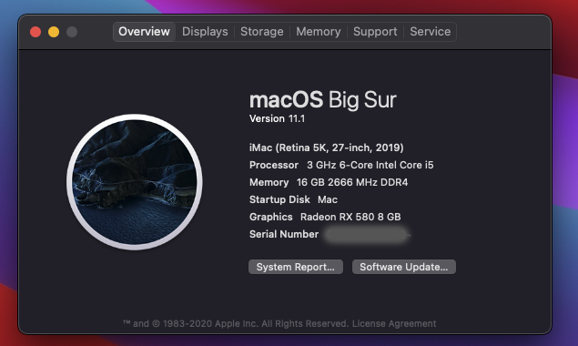

# SFF PCVR Build — macOS (OpenCore EFI)

> [!NOTE]
> **Archived.** This is the OpenCore EFI I used in 2020–2021 to dual-boot macOS and Windows on my small-form-factor PC, which also ran PC VR games on Windows. It's no longer maintained and is shared for reference only. Use it at your own risk.
> OpenCore and the kexts here are from late 2021 (OpenCore 0.7.4). If you're building today, start from the latest releases and the [Dortania OpenCore guide](https://dortania.github.io/OpenCore-Install-Guide/).



## Hardware

| Component | Model | macOS status |
|---|---|---|
| CPU | Intel Core i5-8600K (Coffee Lake) | ✅ native power management |
| Motherboard | Gigabyte [Z390 I AORUS PRO WIFI](https://www.gigabyte.com/Motherboard/Z390-I-AORUS-PRO-WIFI-rev-10) (Mini-ITX) | ✅ |
| GPU | Sapphire Radeon RX 580 8 GB | ✅ natively supported, Metal |
| RAM | 16 GB DDR4-2666 | ✅ |
| Audio | Realtek ALC1220-VB | ✅ via AppleALC |
| Ethernet | Intel I219-V | ✅ via IntelMausi |
| USB | USB-C and USB-A 3.1 Gen 2 | ✅ ports mapped with USBPorts.kext |
| Wi-Fi / Bluetooth | Intel CNVi (onboard) | ❌ see [Wi-Fi](#wi-fi) |

SMBIOS: `iMac19,1`

## Tested on

| OS | Version |
|---|---|
| macOS Catalina | 10.15.6 ✅ |
| macOS Big Sur | 11.1 ✅ |
| macOS Monterey | 12 ✅ |
| Windows 10 | 20H2 ✅ (dual boot) |

Bootloader: [OpenCore 0.7.4](https://github.com/acidanthera/OpenCorePkg/releases/tag/0.7.4)

## What works

Everything except the onboard Wi-Fi: graphics acceleration, audio, Ethernet, all mapped USB ports, sleep, and dual boot with Windows.

### Wi-Fi

The onboard Intel CNVi card isn't supported natively. Replace it with a Broadcom card such as the **BCM94352Z**, or check the [Wireless Buyers Guide](https://dortania.github.io/Wireless-Buyers-Guide/) for supported chipsets.

## Repository contents

```
EFI/
├── BOOT/BOOTx64.efi
└── OC/
    ├── OpenCore.efi
    ├── config.plist     OpenCore config (serial numbers removed, generate your own)
    ├── ACPI/            SSDT-PLUG-DRTNIA, SSDT-EC-USBX-DESKTOP, SSDT-AWAC, SSDT-PMC
    ├── Drivers/         OpenRuntime, OpenHfsPlus
    ├── Kexts/           Lilu, VirtualSMC (+ SMCProcessor, SMCSuperIO), WhateverGreen,
    │                    AppleALC, IntelMausi, USBPorts
    └── Tools/           OpenShell
docs/                    screenshots
```

### ACPI

The Z390 board needs these SSDTs, all included in `EFI/OC/ACPI/`:

| SSDT | Purpose |
|---|---|
| SSDT-PLUG | CPU power management |
| SSDT-EC-USBX | fake embedded controller and USB power properties |
| SSDT-AWAC | fixes the system clock on 300-series boards |
| SSDT-PMC | enables native NVRAM on 300-series boards |

## How to use it

1. **Create a macOS installer** from [macOS](https://dortania.github.io/OpenCore-Install-Guide/installer-guide/mac-install.html), [Windows](https://dortania.github.io/OpenCore-Install-Guide/installer-guide/winblows-install.html), or [Linux](https://dortania.github.io/OpenCore-Install-Guide/installer-guide/linux-install.html).
2. **Mount the EFI partition** of the installer drive with [MountEFI](https://github.com/corpnewt/MountEFI) and copy this repo's `EFI` folder into it.
3. **Generate your own SMBIOS** for `iMac19,1` with [GenSMBIOS](https://github.com/corpnewt/GenSMBIOS) and fill in `SystemSerialNumber`, `MLB`, and `SystemUUID` in `config.plist` (they're set to `GENERATE_YOUR_OWN_*`). Set `ROM` to your Ethernet MAC address. Edit the plist with [ProperTree](https://github.com/corpnewt/ProperTree). Never reuse serials from someone else's config: it breaks iMessage and FaceTime and can get the serial blocked by Apple.
4. **Update OpenCore and the kexts** to the latest releases, following the [OpenCore update guide](https://dortania.github.io/OpenCore-Post-Install/universal/update.html), if you're installing a newer macOS.
5. **Boot and install.** After installation, copy the EFI folder to your system drive's EFI partition.

The config ships with verbose debugging boot arguments (`-v keepsyms=1 debug=0x100`), which help during installation. Remove them for daily use.

If your motherboard is different, your USB map and SSDTs will be too. Use this repo as a reference, not a drop-in.

## References

- [Dortania OpenCore Install Guide](https://dortania.github.io/OpenCore-Install-Guide/)
- [Dortania OpenCore Post-Install](https://dortania.github.io/OpenCore-Post-Install/)
- [Wireless Buyers Guide](https://dortania.github.io/Wireless-Buyers-Guide/)

## License

The configuration and documentation are [MIT](LICENSE) licensed. OpenCore, the drivers, and the kexts are from [acidanthera](https://github.com/acidanthera) and keep their original licenses.
